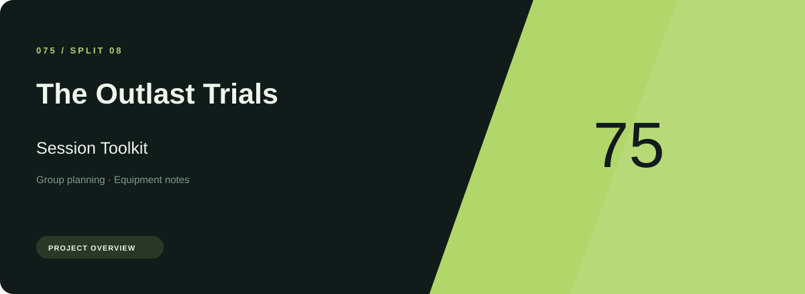
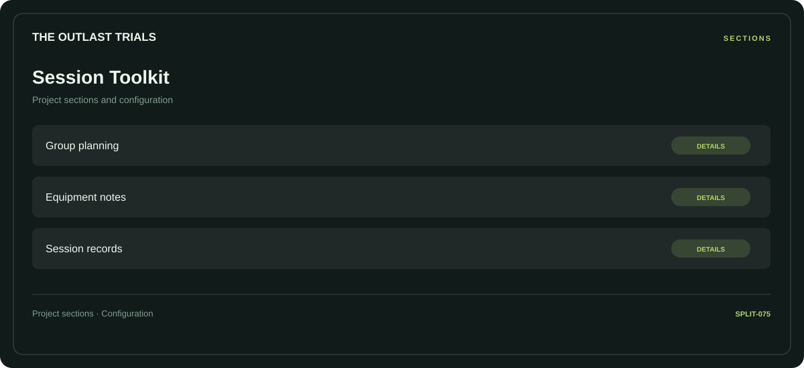

# 🧭 The Outlast Trials Session Toolkit

**Group planning · Equipment notes · Session records**

## ⚡ Features

The Outlast Trials Session Toolkit brings group planning and equipment notes into one section-based interface. Session records provides the third part of the workflow.

### ⚙️ Group planning

A dedicated section for group planning and the configuration details associated with that area.

### 🧩 Equipment notes

Equipment categories and the associated selection or configuration options.

### ⌨️ Session records

Session and activity information grouped by the task or context it belongs to.

## 🖥️ Project navigation

## 📥 Download

The button and cover open the project's download page. Use the information supplied with the downloaded package for installation and release-specific requirements.

## 📚 Project documentation

- [Feature reference](docs/FEATURES.md)
- [Download information](docs/DOWNLOAD.md)
- [Project page](index.html)

---

The Outlast Trials Session Toolkit · Program documentation and download information.
                                                                                                    